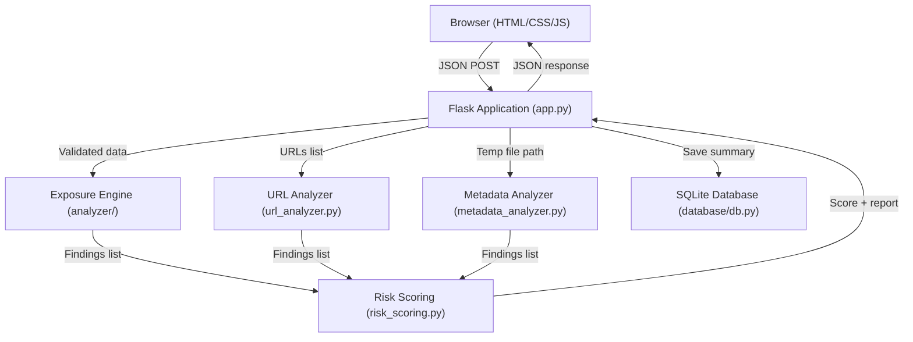

# Digital Shadow — Personal Data Exposure Mapping & Privacy Risk Analyzer

> A locally-runnable cybersecurity and privacy-education tool that helps users understand  
> what personal information they expose online and how to reduce their digital footprint.

---

## Table of Contents

1. [Abstract](#1-abstract)  
2. [Problem Statement](#2-problem-statement)  
3. [Objectives](#3-objectives)  
4. [Existing-System Limitations](#4-existing-system-limitations)  
5. [Proposed Solution](#5-proposed-solution)  
6. [Functional Requirements](#6-functional-requirements)  
7. [Non-Functional Requirements](#7-non-functional-requirements)  
8. [Architecture](#8-architecture)  
9. [Data Flow](#9-data-flow)  
10. [Modules](#10-modules)  
11. [Database Schema](#11-database-schema)  
12. [Risk-Scoring Algorithm](#12-risk-scoring-algorithm)  
13. [API Routes](#13-api-routes)  
14. [Installation](#14-installation)  
15. [Running the Application](#15-running-the-application)  
16. [Running Tests](#16-running-tests)  
17. [Sample Input & Output](#17-sample-input--output)  
18. [Security Considerations](#18-security-considerations)  
19. [Privacy Limitations](#19-privacy-limitations)  
20. [Future Enhancements](#20-future-enhancements)  

---

## 1. Abstract

Digital Shadow is a web-based privacy risk analysis tool. The system accepts personal information that a user
voluntarily shares publicly (usernames, email addresses, profile URLs, public text,
and document metadata) and applies a set of deterministic, rule-based rules to
identify potential privacy exposure indicators.

Every finding includes human-readable evidence, an explanation, a potential
consequence, and a practical mitigation step. A heuristic risk score (0–100) provides
a quick overall assessment, while a detailed breakdown explains every point of the score.

All processing runs locally. No submitted data is sent to any third-party service.
URLs are analyzed structurally — the application never fetches external URLs.

---

## 2. Problem Statement

People routinely share usernames, email addresses, phone numbers, dates of birth,
postal addresses, and profile URLs without understanding how these individually
ordinary pieces of data combine to form a uniquely identifying "digital shadow."

Research by Latanya Sweeney (2000) demonstrated that 87 % of the US population
can be uniquely identified by just three attributes: ZIP code, birth date, and sex.
This aggregation problem is poorly understood by the general public and rarely
explained by social media platforms.

There is no simple, free, locally-runnable tool that:
- accepts public information a user already shares,
- explains which specific items are risky and why,
- provides a transparent, auditable risk score, and
- recommends practical mitigation steps.

---

## 3. Objectives

1. Build a working prototype of a personal data exposure analyzer.
2. Implement deterministic, rule-based analysis covering six exposure categories.
3. Provide an explainable, transparent risk score with a full breakdown.
4. Implement safe URL analysis (structural only — no outbound requests).
5. Implement document metadata extraction for PDF and DOCX files.
6. Display findings, evidence, and recommendations in a clear dashboard.
7. Support JSON and CSV report export.
8. Persist a minimal anonymized report summary to a local SQLite database.
9. Implement security controls appropriate for a web application.
10. Write automated tests and fix all failures before submission.

---

## 4. Existing-System Limitations

| Tool | Limitation |
|---|---|
| HaveIBeenPwned | Only checks breach databases; does not analyze public profile exposure. |
| Pipl / Spokeo | Proprietary, paid, US-centric; no transparency in scoring. |
| Google Alerts | Reactive monitoring, no proactive risk explanation. |
| Generic OSINT frameworks | Require technical expertise; not designed for end users. |

None of these tools: (a) explain the combination risk of multiple attributes, (b) analyze
document metadata, (c) provide an auditable scoring breakdown, or (d) run entirely locally.

---

## 5. Proposed Solution

Digital Shadow accepts user-supplied data through a web form and passes it through a
layered analysis pipeline:

```
User Input → Input Validation → Exposure Engine → URL Analyzer
         → Metadata Analyzer → Risk Scoring → Report Builder → Dashboard
```

The system uses only deterministic rules (no machine learning) so every result is
fully explainable. The frontend is a single-page-style Flask-rendered HTML application
connected to a JSON API.

---

## 6. Functional Requirements

| ID | Requirement |
|---|---|
| FR-1 | Accept username, email, profile URLs, website URLs, and free text. |
| FR-2 | Accept document upload (PDF, DOCX) for metadata analysis. |
| FR-3 | Detect email addresses in supplied data. |
| FR-4 | Detect phone-number patterns in supplied text. |
| FR-5 | Detect date-of-birth patterns. |
| FR-6 | Detect postal-address patterns. |
| FR-7 | Evaluate supplied profile and website URLs. |
| FR-8 | Detect username reuse across supplied URLs. |
| FR-9 | Detect information combination risk. |
| FR-10 | Extract and evaluate PDF and DOCX metadata. |
| FR-11 | Detect non-HTTPS, embedded credentials, suspicious hostnames, tracking params. |
| FR-12 | Compute a heuristic risk score with deduplication and capping at 100. |
| FR-13 | Display findings with evidence, explanation, consequence, and mitigation. |
| FR-14 | Export report as JSON and CSV. |
| FR-15 | Store a minimal anonymized report summary to SQLite. |
| FR-16 | Delete stored reports on request. |
| FR-17 | Provide a fictional demo mode clearly labelled as demonstration data. |

---

## 7. Non-Functional Requirements

| ID | Requirement |
|---|---|
| NFR-1 | All analysis runs locally; no data leaves the application server. |
| NFR-2 | The application must not fetch external URLs (SSRF prevention). |
| NFR-3 | Uploaded files must be deleted immediately after processing. |
| NFR-4 | All database queries must use parameterized statements. |
| NFR-5 | HTTP security headers (CSP, X-Frame-Options, etc.) on every response. |
| NFR-6 | Input validation and size limits on all user-supplied fields. |
| NFR-7 | Output HTML-encoding in JavaScript to prevent XSS. |
| NFR-8 | The application must start and respond within 5 seconds on a standard laptop. |
| NFR-9 | The dashboard must be usable at 320 px and 1920 px viewport widths. |
| NFR-10 | Automated test suite must pass before submission. |

---

## 8. Architecture



---

## 9. Data Flow

1. User fills in the web form and clicks **Analyze**.
2. JavaScript collects field values and POSTs JSON to `/api/analyze`.
3. Flask validates and sanitizes all inputs (length limits, URL format, etc.).
4. The **Exposure Engine** applies all rule categories to the submitted data.
5. The **URL Analyzer** parses each submitted URL locally (no network calls).
6. Findings from both are merged and deduplicated by `rule_id`.
7. The **Risk Scoring** module computes the heuristic score and breakdown.
8. A report dict is assembled and a minimal summary saved to SQLite.
9. The full report JSON is returned to the browser.
10. JavaScript renders the dashboard: gauge, charts, findings, recommendations.

For document uploads:
- File is written to a secure OS temp path.
- Metadata is extracted and analyzed.
- The temp file is deleted immediately.
- Findings are returned as a separate report.

---

## 10. Modules

| File | Purpose |
|---|---|
| `app.py` | Flask application factory, routes, request validation, report builder |
| `config.py` | All tunable parameters (weights, limits, thresholds, headers) |
| `analyzer/patterns.py` | Compiled regex patterns — single source of truth |
| `analyzer/exposure_engine.py` | Orchestrates all exposure rule categories |
| `analyzer/url_analyzer.py` | Structural URL analysis (no network I/O) |
| `analyzer/metadata_analyzer.py` | PDF and DOCX metadata extraction |
| `analyzer/risk_scoring.py` | Score computation, deduplication, category mapping |
| `analyzer/recommendations.py` | Per-rule mitigation advice dictionary |
| `database/db.py` | SQLite CRUD using only `sqlite3` stdlib |
| `static/css/style.css` | Complete dark-theme design system |
| `static/js/app.js` | Frontend logic — form, API, rendering, export |
| `templates/index.html` | Main dashboard page |
| `templates/about.html` | Project overview and API reference |
| `templates/report.html` | Stored report viewer |
| `templates/404.html` | Error page |
| `tests/` | Automated test suite (pytest) |

---

## 11. Database Schema

```sql
CREATE TABLE reports (
    report_id       TEXT PRIMARY KEY,      -- UUID v4
    created_at      TEXT NOT NULL,         -- ISO-8601 UTC timestamp
    risk_score      INTEGER NOT NULL,      -- 0–100
    risk_category   TEXT NOT NULL,         -- Low / Moderate / High / Critical
    total_findings  INTEGER NOT NULL,
    low_count       INTEGER NOT NULL DEFAULT 0,
    medium_count    INTEGER NOT NULL DEFAULT 0,
    high_count      INTEGER NOT NULL DEFAULT 0,
    critical_count  INTEGER NOT NULL DEFAULT 0,
    score_breakdown TEXT,                  -- JSON array of breakdown steps
    disclaimer      TEXT                   -- Heuristic disclaimer string
);
```

**What is NOT stored:**
- Raw user input (username, email, text, URLs)
- Uploaded file content or metadata values
- IP addresses or session identifiers
- Any personal information beyond aggregate counts

---

## 12. Risk-Scoring Algorithm

Each finding receives a severity-based score contribution:

| Severity | Points |
|---|---|
| Low | 5 |
| Medium | 10 |
| High | 20 |
| Critical | 30 |

**Rules:**
1. Each `rule_id` is counted **at most once** (deduplication).
2. Running total is **capped at 100**.
3. Score is mapped to a risk category:
   - 0–19 → **Low**
   - 20–39 → **Moderate**
   - 40–69 → **High**
   - 70–100 → **Critical**

**IMPORTANT DISCLAIMER:** This score is a heuristic prototype estimate. It is NOT a
probability of identity theft, a formal security audit, or a legal assessment.
The weights are not empirically validated. Treat the score as a rough indicator only.

---

## 13. API Routes

| Method | Path | Description |
|---|---|---|
| `GET` | `/` | Main analyzer dashboard |
| `GET` | `/about` | About and documentation page |
| `GET` | `/report/<id>` | Stored report viewer (HTML) |
| `POST` | `/api/analyze` | Run exposure analysis on JSON payload |
| `POST` | `/api/analyze-document` | Extract and analyze document metadata |
| `GET` | `/api/report/<id>` | Retrieve stored report summary (JSON) |
| `DELETE` | `/api/report/<id>` | Delete a stored report |
| `GET` | `/api/health` | Health check → `{"status": "ok"}` |

### POST /api/analyze — Request Body

```json
{
  "username": "string (optional, max 64 chars)",
  "email": "string (optional, max 254 chars)",
  "profile_urls": ["https://...", "https://..."],
  "website_urls": ["https://..."],
  "profile_text": "string (optional, max 8000 chars)"
}
```

### POST /api/analyze — Response

```json
{
  "report_id": "uuid",
  "timestamp": "2024-01-01T00:00:00+00:00",
  "findings": [ { "rule_id": "...", "severity": "...", "evidence": "...", ... } ],
  "severity_counts": { "low": 1, "medium": 2, "high": 1, "critical": 0 },
  "categories": { "Contact Information Exposure": 2 },
  "total_findings": 4,
  "scoring": {
    "total_score": 35,
    "risk_category": "Moderate",
    "score_breakdown": [...],
    "disclaimer": "..."
  },
  "recommendations": [ { "severity": "high", "action": "...", "detail": "..." } ],
  "limitations": [...]
}
```

---

## 14. Installation

### Prerequisites

- Python 3.10 or newer
- pip
- A modern web browser

### Steps

```bash
# 1. Navigate to the project directory
cd DigitalShadow

# 2. Create a virtual environment
python -m venv .venv

# 3. Activate it
# Windows (PowerShell):
.venv\Scripts\Activate.ps1
# macOS / Linux:
source .venv/bin/activate

# 4. Install dependencies
pip install -r requirements.txt
```

---

## 15. Running the Application

```bash
# Development mode (auto-reload on file changes):
python app.py

# Or using Flask CLI:
flask --app app run --debug
```

Open your browser at: **http://127.0.0.1:5000**

---

## 16. Running Tests

```bash
# Run all tests with verbose output:
pytest tests/ -v

# Run a specific test file:
pytest tests/test_analyzer.py -v
pytest tests/test_scoring.py -v
pytest tests/test_routes.py -v
pytest tests/test_security.py -v

# With coverage (requires pytest-cov):
pip install pytest-cov
pytest tests/ --cov=. --cov-report=term-missing
```

---

## 17. Sample Input & Output

### Demo mode (fictional data)

Click the **"Try Demo (Fictional Data)"** button to auto-populate the form with:

- Username: `alex_nova_dev`
- Email: `alex.nova.demo@example-fictional.com`
- Profile URLs: GitHub, Twitter (fictional), LinkedIn (HTTP)
- Profile text: Contains a phone number, date of birth, and street address

Expected output (approximate):
- Risk Score: **~75 (Critical)**
- Findings: 10–12
- Categories triggered: Contact Exposure, Personal Info, Profile Exposure, URL Risk, Combination Risk

### Manual test

```bash
curl -X POST http://127.0.0.1:5000/api/analyze \
  -H "Content-Type: application/json" \
  -d '{"email":"test@fictional-example.com","username":"fictional_user_test"}'
```

---

## 18. Security Considerations

1. **No SSRF:** The URL analyzer never makes outbound HTTP requests. All analysis is structural (parsing only).
2. **File upload safety:** Uploaded files are written to OS temp with a random name, processed, and immediately deleted. File content is never executed.
3. **Input limits:** All text fields have strict maximum lengths enforced on the backend. Excess content is silently truncated.
4. **Parameterized SQL:** All database queries use parameterized statements; no string concatenation.
5. **XSS prevention:** All user-supplied content is HTML-encoded in JavaScript via `escapeHtml()` before insertion into the DOM.
6. **Security headers:** Every response includes `X-Content-Type-Options`, `X-Frame-Options`, `Referrer-Policy`, `X-XSS-Protection`, and `Content-Security-Policy`.
7. **Report IDs are UUIDs:** Not sequential, not enumerable.
8. **No credential logging:** Credentials embedded in URLs are redacted before being included in any evidence string.

---

## 19. Privacy Limitations

- Analysis is limited to information you voluntarily submit. The system cannot search the internet.
- Phone number and address detection uses heuristic patterns; false positives are possible.
- URL analysis is structural only; the application does not verify whether a URL is live or reachable.
- The risk score is a heuristic estimate; it should not be used for legal, compliance, or insurance purposes.
- Document metadata extraction depends on the format and the quality of available libraries; some metadata fields may not be accessible.
- SQLite is not suitable for multi-user production deployments. Use PostgreSQL with a persistent volume for production.

---

## 20. Future Enhancements

| Priority | Enhancement |
|---|---|
| High | Optional integration with HaveIBeenPwned API (with explicit user consent) |
| High | DOCX extended metadata (comments, revision history) |
| Medium | PDF image metadata (EXIF in embedded images) |
| Medium | Multi-user authentication with per-user report history |
| Medium | Trend view — compare multiple analyses over time |
| Low | Optional constrained external URL verification (with DNS/IP blocklist) |
| Low | Browser extension that analyzes the current page's contact exposure |
| Low | Exportable HTML/PDF report with print stylesheet |

---

*Digital Shadow is a prototype for educational purposes. It is not a commercial product
and does not guarantee completeness, accuracy, or legal compliance.*
